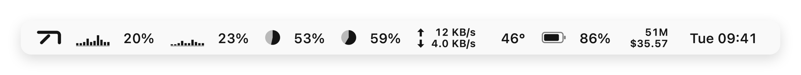
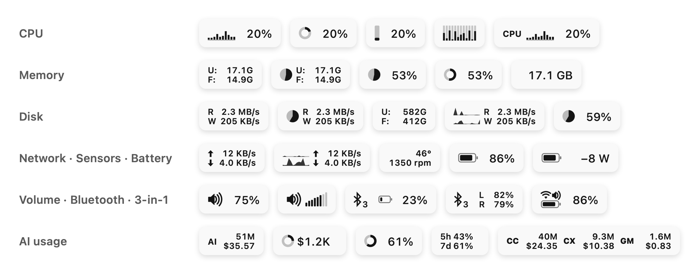
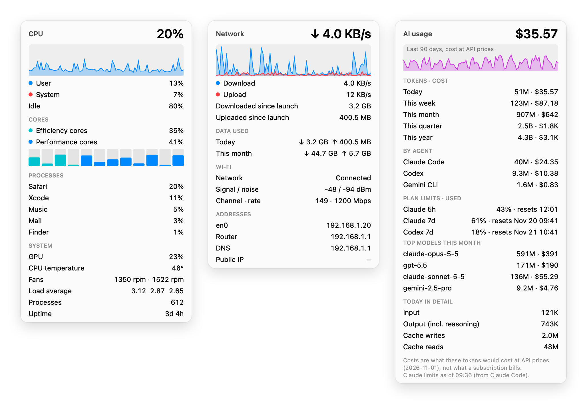
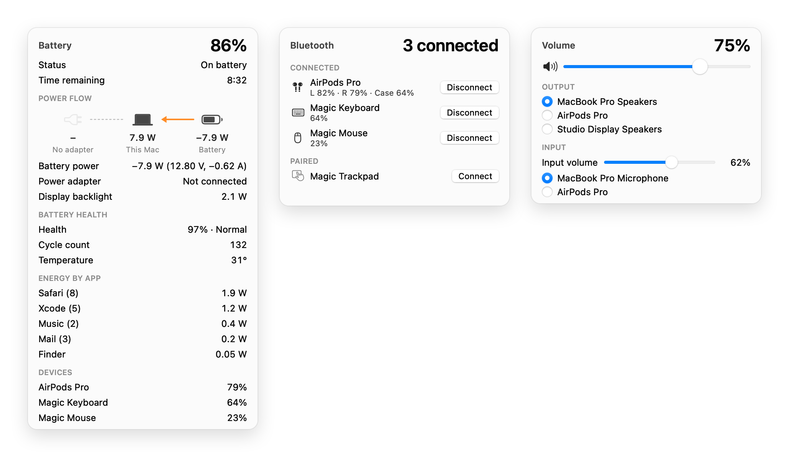

<div align="center">


# BarTap

**A tidy menu bar, live system stats and your AI coding usage, in one small macOS app that never fights you for the mouse.**

<a href="https://github.com/ChenFangfc/BarTap/releases/latest/download/BarTap.dmg"></a>


<a href="README.zh-CN.md"></a>

**[Download](https://github.com/ChenFangfc/BarTap/releases/latest/download/BarTap.dmg)** · [Features](#features) · [Install](#install) · [Why it can't twitch](#why-it-cant-twitch) · [Build](#build-from-source)

<br>

<a href="https://chenfangfc.github.io/BarTap/media/bartap-film-en.mp4"></a>

<sub><a href="https://chenfangfc.github.io/BarTap/media/bartap-film-en.mp4"><b>▶ Watch with sound (0:37)</b></a> · <a href="https://chenfangfc.github.io/BarTap/media/bartap-film-zh.mp4"><b>▶ 中文版</b></a></sub>

</div>

---

BarTap hides the menu bar icons you don't need behind one divider, keeps CPU, GPU, memory, disk, network, sensors, battery and a clock live in the bar, and shows how much your AI coding agents have used. Hiding never fakes a click, taps your input or warps the cursor, so the screen never twitches. Icons move only when you ask: arrange them in Settings › Layout, click Apply, and BarTap makes the ⌘-drags for you, stopping the moment you touch the mouse.

## Features

<picture>
  <source media="(prefers-color-scheme: dark)" srcset="docs/media/bar-dark.webp">
  
</picture>

**Organize**
- Hide icons behind the toggle. An optional ‖ section keeps some hidden for good.
- Rest the pointer on the BarTap button to peek at the hidden icons: they hide again when it leaves. Click it and they stay until you click elsewhere. Scrolling and a hotkey (⌃⌥⌘B) work too.
- On a notched Mac, a click can open the shelf: a Bartender-style dropdown with the hidden icons, real images included. Click one to open its menu.
- Arrange the whole menu bar in **Settings › Layout**: real icons in rows for Shown, Hidden and Always Hidden, BarTap's own stats items included. Drag icons between the rows and along them, then click Apply. Only the icons you moved move.
- Pick the expand/collapse button: the BarTap logo, an arrow, a dot, an ellipsis, lines or a grid.
- One arrangement for every display: a wide screen hides exactly what a narrow one hides. If a display is too narrow for every shown icon, Settings › Layout names it.
- Search any menu bar icon (⌃⌥⌘F).
- Rules reveal icons on a large display, in chosen apps, on low battery or when you're offline.
- Clean menu bar for screenshots, tighter icon spacing, Keep Awake and a color picker.

**Monitor**
- Eleven modules, refreshed every second. Build each item from elements in any order (graph, bar, pie, ring, percentage, U:/F:, R:/W:, ↑↓, label…), or pick a preset. Reorder the items too.
- **Volume**: level and mute in the bar, scroll on it to change the volume, switch output and input devices from its dropdown.
- **Bluetooth**: paired devices and their batteries (AirPods left, right and case too); connect or disconnect with one click.
- **3-in-1**: battery, Wi-Fi and volume in one small icon.
- **Battery power flow**: adapter, Mac and battery in watts, plus health, cycles and which apps use the energy.
- Details open when you rest the pointer on an item (passing over doesn't count) and close when it leaves; a click keeps them open until you click elsewhere. Inside: history graphs, per-core load, top processes, Wi-Fi details, daily and monthly data use, temperatures, fans, power, battery health and Bluetooth device batteries.
- Alerts for a lost connection, a full battery, high CPU or heat, memory pressure, a low disk and a low battery.
- World clocks, a calendar, °F and bits. Combine all stats into one item to save space by the notch.

**Video downloads**
- Paste or drop a link, pick one of the qualities the video really has, the format and where to save, and download. Pause, resume or cancel; open the file when it's done.
- Options when you need them: subtitles, playlists, a time range, cover and chapters, skipping sponsor segments, signing in through your browser, a speed limit and file names.
- Built on [yt-dlp](https://github.com/yt-dlp/yt-dlp): BarTap uses yours from Homebrew, or fetches its official release (checksum verified) when you ask. Download only what you have the right to.

**AI usage**
- Tokens and cost of Claude Code, Codex, Gemini CLI, OpenCode, Kilo Code, Qwen Code and Kimi Code, read from their logs on your Mac. No API keys, no sign-in, nothing uploaded.
- Today, this week, month, quarter or year, for all agents, a few or one. Show their total, or each agent side by side.
- Cost is what the tokens would cost at API prices (LiteLLM's public price list), so a subscription shows what its usage is worth.
- Plan limits as Claude Code and Codex report them: 5-hour and weekly, used or left, with reset times. Claude's usage credits too: how much of your monthly limit is spent.

<picture>
  <source media="(prefers-color-scheme: dark)" srcset="docs/media/layouts-dark.webp">
  
</picture>

<picture>
  <source media="(prefers-color-scheme: dark)" srcset="docs/media/panels-dark.webp">
  
</picture>

<picture>
  <source media="(prefers-color-scheme: dark)" srcset="docs/media/panels2-dark.webp">
  
</picture>

## Install

1. [Download BarTap.dmg](https://github.com/ChenFangfc/BarTap/releases/latest/download/BarTap.dmg), open it and drag BarTap to Applications.
2. BarTap is self-signed, not notarized. If macOS blocks the first launch, open **System Settings › Privacy & Security** and click **Open Anyway**. You only do this once.
3. Choose what to hide in **Settings › Layout** (or hold ⌘ and drag icons left of the │ divider yourself). Turn on stats and AI usage in **Settings › Stats**.

Hiding and AI usage need no permission. Two optional ones: **Accessibility** enables the shelf, search and Settings › Layout (including Apply, which moves icons for you), and **Screen Recording** shows real icons there. Both stay granted when you update. Quit any other menu bar manager first.

## Why it can't twitch

Organizers that move icons for you post synthetic ⌘-drags in the background, sometimes while freezing or warping the cursor. When macOS lags, those events land in the wrong place: the screen jumps and the mouse fights back.

Hiding in BarTap only changes the length of its own divider items: no input events, no event taps, no cursor warps. Icons move only when you click **Apply** in Settings › Layout. BarTap then makes one ⌘-drag per icon, as you would, with the pointer hidden and put back afterwards. It reads the menu bar again after every move and stops for good the moment you touch the mouse or keyboard. It never freezes the pointer, never blocks a click and never moves anything on its own. [`scripts/build.sh`](scripts/build.sh) fails the build if the binary links an event tap, cursor warp, input suppression or keyboard event API, or if mouse events are created anywhere but that one Apply path. Quit BarTap and every icon comes straight back.

## Light by design

Idle, BarTap uses about **0.02% CPU** and **~40 MB** of memory. Four live stats refreshed every second add **1–3% CPU**, depending on how many displays draw the menu bar (macOS redraws each changed item on every one). Unchanged readouts are never redrawn, and details and process lists are sampled only while a dropdown is open. AI usage reads only the lines an agent adds, a few seconds after it writes them; the first pass over a long history takes seconds (7 GB of logs: about 11 s). There is no daemon and no root helper. The only network requests are the public IP lookup, if you turn it on, a weekly download of the public model price list while AI usage is on (you can turn that off), and the video downloads you start (plus yt-dlp's official release, when you install or update it).

<sub>Measured on a MacBook Pro (M2 Max) running macOS 26.</sub>

## Build from source

You need macOS 13+ and the Xcode Command Line Tools (Swift 5.10+).

```bash
git clone https://github.com/ChenFangfc/BarTap.git && cd BarTap
scripts/build.sh    # tests, universal build, input-API guard -> dist/BarTap.app and the DMG
```

The film is code too. `promo/build.sh` renders it from BarTap's own drawing code and sample data.
