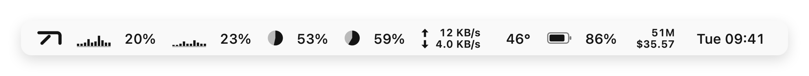
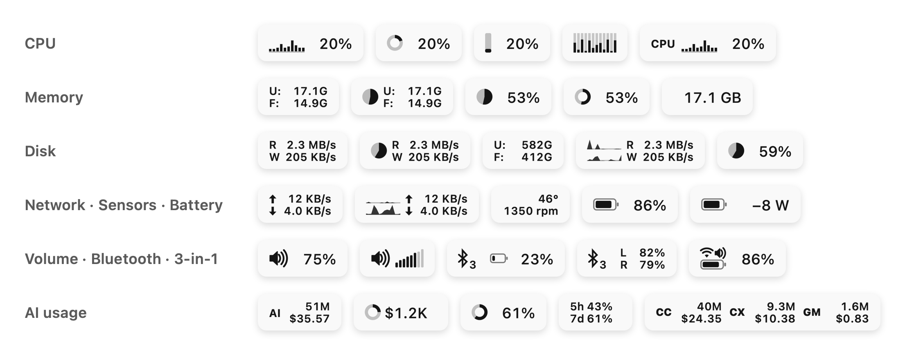
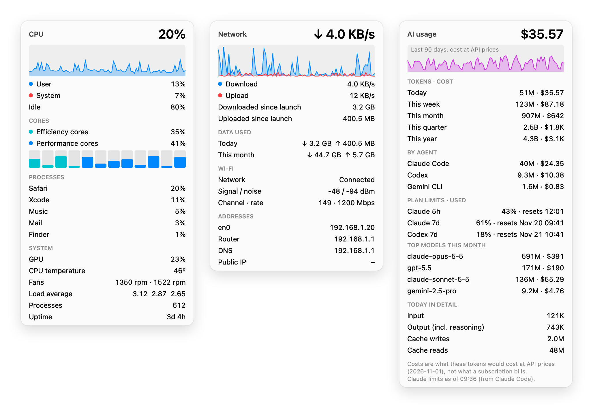
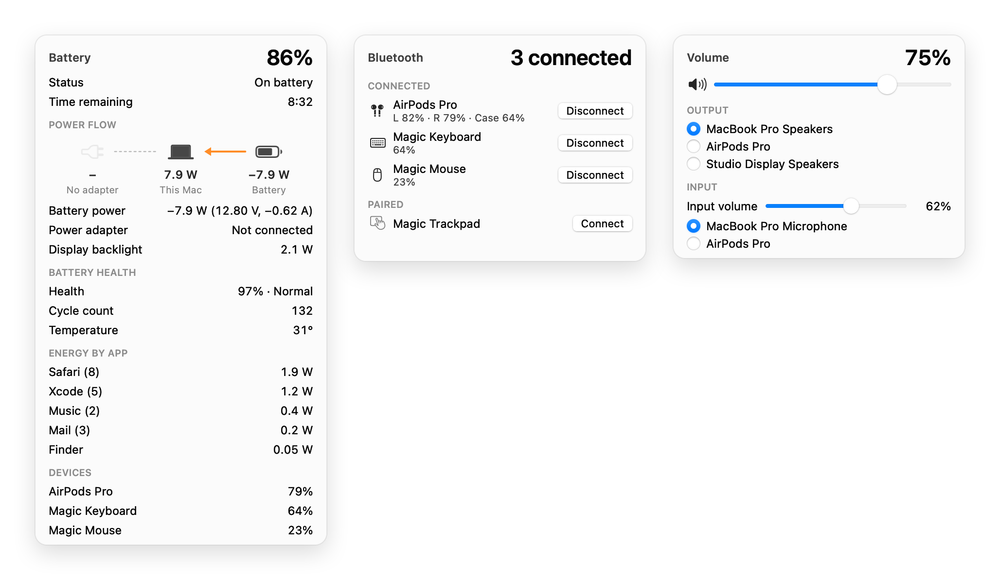
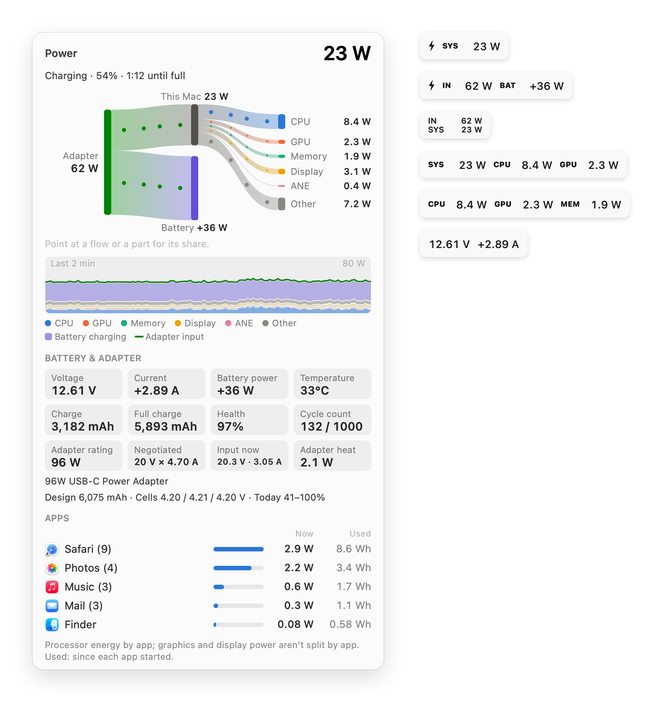

<div align="center">



# BarTap

**整理菜单栏、实时系统监控、AI 编程用量，一个轻巧的 macOS 小工具，而且从不和你抢鼠标。**

<a href="https://github.com/ChenFangfc/BarTap/releases/latest/download/BarTap.dmg"></a>


<a href="README.md"></a>

**[下载](https://github.com/ChenFangfc/BarTap/releases/latest/download/BarTap.dmg)** · [功能](#功能) · [安装](#安装) · [为什么不会抽动](#为什么不会抽动) · [从源码构建](#从源码构建)

<br>

<a href="https://chenfangfc.github.io/BarTap/media/bartap-film-zh.mp4"></a>

<sub><a href="https://chenfangfc.github.io/BarTap/media/bartap-film-zh.mp4"><b>▶ 带声音观看（0:49）</b></a> · <a href="https://chenfangfc.github.io/BarTap/media/bartap-film-en.mp4"><b>▶ English</b></a></sub>

</div>

---

BarTap 把用不上的菜单栏图标收到一条分隔线后面，在菜单栏里实时显示 CPU、GPU、内存、磁盘、网络、传感器、电池、用电和时间，看清每一瓦电的去向，还能显示你的 AI 编程工具用了多少。隐藏图标时它不伪造点击、不拦截输入、不瞬移指针，所以屏幕不会抽动。图标只在你要求时才移动：在「设置 › 布局」里排好，点「应用」，BarTap 替你完成 ⌘ 拖动，你一碰鼠标就立刻停下。

## 功能

<picture>
  <source media="(prefers-color-scheme: dark)" srcset="docs/media/bar-dark.webp">
  
</picture>

**整理**
- 把图标收到开关左侧；可选的 ‖ 区域让部分图标一直隐藏。
- 指针停在 BarTap 按钮上就能看一眼隐藏的图标，离开后自动收起；点按则一直显示，直到你点按别处。也可以用滚动或快捷键（⌃⌥⌘B）。
- 刘海屏 Mac 上，点一下可以弹出图标架：一排列出被隐藏的图标（可显示真实图标，按原尺寸清晰显示），点哪个就打开哪个的菜单。
- 在 **设置 › 布局** 里排列整条菜单栏：真实图标分成「显示」「隐藏」「始终隐藏」几行，BarTap 自己的监控项也在其中。在行与行之间、同一行左右拖动，然后点「应用」，只有你拖过的图标才会移动。
- 展开/收起按钮可选：BarTap 标志、箭头、圆点、省略号、横线或网格。
- 所有屏幕共用一套设置：宽屏隐藏的图标和窄屏完全一样。如果某块屏幕太窄、放不下所有显示的图标，「设置 › 布局」会指出是哪一块。
- 搜索任意菜单栏图标（⌃⌥⌘F）。
- 自动规则：接大屏、切到指定应用、电量低或断网时自动显示。
- 一键干净菜单栏（截图、演示用）、更紧凑的图标间距、防休眠、取色器。
- 合盖不睡眠（相当于 `pmset -a disablesleep 1`）：开启时输入一次管理员密码，关闭不需要。BarTap 退出或电量低时会自动恢复正常睡眠。

**监控**
- 十二个模块，每秒刷新。每一项都能用元素自由组合、自由排序（曲线、柱条、饼图、圆环、百分比、U:/F:、R:/W:、↑↓、标签……），也可以直接选预设；各项在菜单栏里的先后顺序也能调。
- **音量**：菜单栏里显示音量和静音，在上面滚动即可调节音量，下拉菜单里切换输出、输入设备。
- **蓝牙**：已配对设备及电量（AirPods 左耳、右耳和充电盒也有），一键连接或断开。
- **三合一**：电池、Wi-Fi 和音量合成一个小图标。
- **电池功率流向**：电源适配器、Mac 和电池各自的瓦数，外加健康度、循环次数，以及哪些 App 在耗电。
- **用电**：充电器输入多少瓦、充进电池多少瓦，以及整机的电都用在哪里：CPU、GPU、内存、屏幕、神经引擎和其他部分，实时显示瓦数。可以任选一项或多项显示在菜单栏。详情页用一张会流动的关系图画出电从适配器或电池流向各个部件的去向，还有最近两分钟的曲线、电池电压、电流、温度、容量、健康度和循环次数、适配器额定功率与当前输入，以及每个 App 的功率和累计用电。不需要管理员密码，也不装后台程序。
- 指针在监控项上停一下就会展开详情（只是划过不会），离开即收起；点按则一直显示，直到你点按别处。详情里有历史曲线、每核负载、占用最高的进程、Wi-Fi 详情、每日/每月流量、温度、风扇、功耗、电池健康度和蓝牙设备电量。
- 提醒：断网/恢复、充满电、CPU 占用或温度过高、内存压力、磁盘将满、电量低。
- 世界时钟和日历，支持 °F 和 bit 单位；还能把所有监控合并成一个图标，给刘海旁边省空间。

**视频下载**
- 在「设置 › 视频下载」（或右键 BarTap 按钮 › 下载视频…，也可以设快捷键）里粘贴或拖入链接，从视频实际提供的清晰度里选一个，再选格式和存放位置，就能下载。可以暂停、继续、取消，下完直接打开。
- 需要时再展开选项：字幕、播放列表、截取时间段、封面与章节、跳过赞助片段、用浏览器登录、限速和文件名。
- 基于 [yt-dlp](https://github.com/yt-dlp/yt-dlp)：BarTap 会使用 Homebrew 装的版本，或在你要求时从官方发布页获取（会校验校验和）。请只下载你有权下载的内容。

**AI 用量**
- 从本机日志统计 Claude Code、Codex、Gemini CLI、OpenCode、Kilo Code、Qwen Code、Kimi Code 的 token 和费用。不要 API 密钥，不用登录，不上传任何东西。
- 今天、本周、本月、本季度、今年；可以统计全部、其中几个或单个工具，显示总和，或每个工具并排显示。
- 费用 = 这些 token 按 API 价格要花多少钱（LiteLLM 公开价目表），订阅套餐也能看出用量折合多少钱。
- 套餐额度按 Claude Code 和 Codex 自己的记录显示：5 小时和每周额度，可选显示已用或剩余，附重置时间；还有 Claude 额外用量（API 额度）这个月的上限用掉了多少。

<picture>
  <source media="(prefers-color-scheme: dark)" srcset="docs/media/layouts-dark.webp">
  
</picture>

<picture>
  <source media="(prefers-color-scheme: dark)" srcset="docs/media/panels-dark.webp">
  
</picture>

<picture>
  <source media="(prefers-color-scheme: dark)" srcset="docs/media/panels2-dark.webp">
  
</picture>

<picture>
  <source media="(prefers-color-scheme: dark)" srcset="docs/media/power-dark.webp">
  
</picture>

## 安装

1. [下载 BarTap.dmg](https://github.com/ChenFangfc/BarTap/releases/latest/download/BarTap.dmg)，打开后把 BarTap 拖进「应用程序」。
2. BarTap 没有经过 Apple 公证。第一次打开如果被拦，去 **系统设置 › 隐私与安全性**，点 **仍要打开**，只需一次。
3. 在 **设置 › 布局** 里选择隐藏哪些图标（也可以自己按住 ⌘ 把图标拖到 │ 分隔线左边）。系统监控和 AI 用量在 **设置 › 系统监控** 里打开。

隐藏图标和 AI 用量都不需要任何权限。另有两个可选权限：**辅助功能**用于图标架、搜索和「设置 › 布局」（包括替你移动图标的「应用」）；**录屏**让这些地方显示真实图标。升级后两项权限都会保留。请先退出其他菜单栏管理工具。

## 为什么不会抽动

替你挪图标的整理工具，会在后台发送模拟的 ⌘ 拖动，有时还会冻结或瞬移指针。系统一卡，这些事件就落错地方：屏幕跳动，鼠标也不听使唤。

BarTap 隐藏图标时只改变自己分隔线的长度：不发送输入事件、不安装事件监听、不瞬移指针。图标只在你于「设置 › 布局」点 **应用** 时才会移动：BarTap 像你一样逐个 ⌘ 拖动，期间隐藏指针、结束后放回原处；每移动一次都重新读取菜单栏，你一碰鼠标或键盘就彻底停下。它从不冻结指针、从不拦截点击，也从不自作主张移动任何东西。只要二进制链接了事件监听、指针瞬移、输入屏蔽或键盘事件相关的 API，或者在「应用」这条路径之外创建了鼠标事件，[`scripts/build.sh`](scripts/build.sh) 就会让构建失败。退出 BarTap，所有图标立刻恢复原样。

## 轻量

空闲时 BarTap 大约只占 **0.02% CPU** 和 **约 40 MB** 内存；再开四项每秒刷新的监控，CPU 多 **1–3%**，取决于有几块屏幕在显示菜单栏（macOS 会在每块屏幕上重绘有变化的那一项）。数值没变就不重绘，详情和进程列表只在下拉菜单打开时才采样。AI 用量只读取工具新写入的那几行，写入后几秒内更新；第一次读取很长的历史需要几秒（7 GB 日志约 11 秒）。没有后台守护进程，也没有 root 助手；只有开着「合盖不睡眠」时，会用你授权的管理员权限运行一个小脚本，关闭后它恢复睡眠并退出。BarTap 只在这些情况下联网：你打开了「显示公网 IP」；开着 AI 用量时每周下载一次公开的模型价目表（可以关掉）；以及你发起的视频下载（安装或更新 yt-dlp 时，会从它的官方发布页下载）。

<sub>测试机：MacBook Pro（M2 Max），macOS 26。</sub>

## 从源码构建

需要 macOS 13+ 和 Xcode Command Line Tools（Swift 5.10+）。

```bash
git clone https://github.com/ChenFangfc/BarTap.git && cd BarTap
scripts/build.sh    # 单元测试、通用二进制、输入 API 检查 -> dist/BarTap.app 和 DMG
```

宣传片也是代码：`promo/build.sh` 用 BarTap 自己的绘制代码和示例数据渲染出来。
